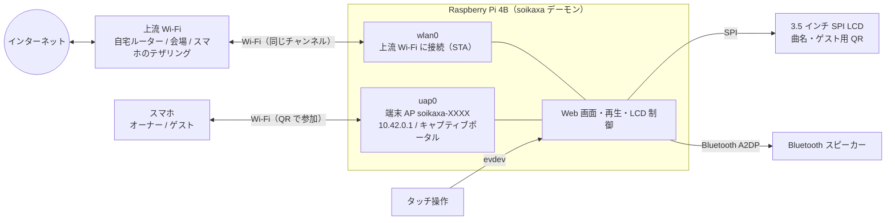

# アーキテクチャ

詳細設計は `output/design/ARCH_001_soikaxa.md`。ここは現在のコード配置の索引。

## 装置構成（ネットワーク・入出力）

Pi の Wi-Fi チップ 1 つで、役割の違う 2 つの Wi-Fi を同時に使う。

- **上流 Wi-Fi（STA、`wlan0`）**: Pi が「子機」として自宅 Wi-Fi やスマホのテザリングにつなぐ。インターネット（音源の検索・取得、yt-dlp の更新）に使う。複数登録でき、起動時に自動で選ぶ。無くてもローカル MP3 は再生できる
- **端末 AP（`uap0`、SSID `soikaxa-XXXX`）**: Pi が「親機」になり、スマホを直接つなぐ。Web 画面（`http://10.42.0.1/`）はこちらからだけ開ける。常時 ON
- 2 つは同じチップなので**同じチャンネルでしか同時に動かない**（AP が上流のチャンネルに合わせる）。上流が 5GHz の DFS チャンネル（52〜144）だと AP が立たないため、**上流は 2.4GHz に限る**（屋外利用も考慮。`WifiManager.add_and_connect` が `band bg` で登録する）



有線 LAN（`eth0`）はセットアップ中の SSH 用で、製品としては使わない。

## エントリーポイント

`python -m soikaxa.daemon` → `soikaxa.bootstrap.main()`。初期化順: 設定読込・AP 資格情報生成 → アダプタ読込 → mpv 起動 → `PlayerService` → LCD → AP 起動 → 上流確認 → スピーカー接続（別スレッド）→ 監視スレッド → タッチ → Web（uvicorn）。`READY=1` と `WATCHDOG=1` を systemd に通知。

## レイヤー

| レイヤー | モジュール |
| -------- | ---------- |
| プレゼンテーション | `web/`, `lcd/`, `touch.py` |
| アプリケーション | `daemon.py`（`PlayerService`）, `bootstrap.py` |
| ドメイン（I/O なし） | `queue.py`, `state.py`, `adapters/base.py` |
| インフラ | `player.py`, `net.py`, `bt.py`, `portal.py`, `config.py`, `auth.py`, `health.py`, `upgrade.py`, `watchdog.py`, `runner.py`, `adapters/local_mp3.py`, `adapters/registry.py` |

禁止依存は `scripts/check_deps.py` が検査（純粋層の I/O import、コアからのアダプタ import、web からの player/runner 直接 import、コアへの音源固有名の混入、README の命名）。

## ディレクトリ構成

```text
core/soikaxa/            # コアパッケージ（音源を知らない）
├── adapters/            # 4 関数 I/F、AuthCapable、registry、ローカル MP3
├── lcd/                 # 画面描画・回転レコード・RGB565・LcdController
├── web/                 # FastAPI と static/（index.html, jsQR.js）
└── *.py                 # runner/config/auth/state/queue/player/net/bt/portal/touch/health/watchdog/daemon/bootstrap/fakes
adapters/soikaxa-adapter-ytmusic/  # 音源アダプタ（将来は別リポジトリ）
scripts/                 # deploy（Mac→Pi）/ install（Pi で一括）/ upgrade（ソフトウェア更新）/ 01_setup / 02_verify / 03_install / 04_report / update_ytdlp / check_deps
systemd/                 # soikaxa@, soikaxa-uap0, soikaxa-update@(.timer), soikaxa-upgrade@（root・手動起動）, soikaxa-health@(.timer), polkit
tests/                   # コアのテスト
```

## テスト構成

| テストファイル | 対象 |
| -------------- | ---- |
| `tests/test_foundation.py` | runner, config, auth, watchdog |
| `tests/test_queue_state.py` | queue, state |
| `tests/test_player.py` | mpv IPC（FakeTransport, _Dispatcher） |
| `tests/test_net_portal.py` | nmcli コマンド生成・パース、ポータル |
| `tests/test_bt_health_touch.py` | bluetoothctl、ヘルスチェック、タッチ判定 |
| `tests/test_lcd.py` | 画面・QR・RGB565・回転レコード |
| `tests/test_adapters.py` | registry、ローカル MP3 |
| `tests/test_daemon.py` | PlayerService（連続再生・キュー優先・スキップ・フォールバック・先読み） |
| `tests/test_controller_bootstrap.py` | LcdController、起動ヘルパ |
| `tests/test_web.py` | API の権限・CSRF・PIN ロック・上限・ポータル |
| `tests/test_deps.py` | 依存方向、base.py 無変更 |
| `adapters/soikaxa-adapter-ytmusic/tests/test_ytmusic.py` | ytmusic アダプタ（ytmusicapi / yt-dlp を Mock） |

## ドキュメント責務

| ファイル                      | 責務                                                   |
| ----------------------------- | ------------------------------------------------------ |
| `docs/PRD.md` / `docs/DECISIONS.md` | 一次仕様・設計判断（input から取込） |
| `docs/project.md`             | コマンド、技術スタック、環境変数、ルーティング         |
| `docs/setup-raspberry-pi.md`  | 実機（Pi 4B）のセットアップと動作確認の手順            |
| `docs/architecture.md`        | ディレクトリ構成、テスト一覧、ドキュメント責務         |
| `docs/data-model.md`          | 設定スキーマ、バリデーションルール                     |
| `docs/development-patterns.md`| コード規約、落とし穴                                   |
