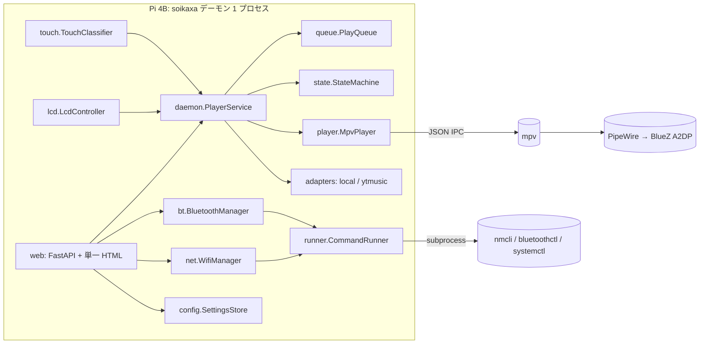

# ARCH_001 — SoiKaxa ソフトウェアアーキテクチャ

- 版: 1.0（2026-11-21）/ 入力: `output/prd/PRD_001_soikaxa.md`
- 対象: Raspberry Pi 4B（Bookworm, Python 3.11）で動く単一デーモン。開発 PC では外部プロセスを Mock して検証

---

## 1. アーキテクチャ概要

### 設計方針

1. **単一プロセス・単一デーモン**: 再生・Web・LCD・タッチを 1 プロセスのスレッドで動かす（IPC を作らない＝最小）。systemd が監視・再起動
2. **コアは音源を知らない**: 音源は `SourceAdapter`（4 関数）だけ。認証登録のようなアダプタ固有操作は任意の別 Protocol（`AuthCapable`）で表し、`base.py` は変更しない
3. **外部コマンドは注入**: mpv 以外の外部コマンド（nmcli / bluetoothctl / systemctl / vcgencmd）は `CommandRunner` 経由。mpv は Unix ソケット（JSON IPC）を `MpvTransport` 経由。テストはフェイクを差す
4. **アプリケーションサービス層**: Web と LCD/タッチは `PlayerService`（daemon）と各マネージャの公開メソッドだけを呼ぶ

### 構成図



### 主要判断

| # | 判断 | 理由 | 却下案 |
| --- | --- | --- | --- |
| A-01 | Web・LCD・再生を 1 プロセスに同居 | IPC・認証境界を増やさない。Pi 4B の資源で十分 | Web と daemon を別プロセス + UNIX ソケット |
| A-02 | 認証登録は任意 Protocol `AuthCapable` | 4 関数 I/F を増やさずにアダプタ固有操作を表せる | `SourceAdapter` に関数追加（D-09 違反） |
| A-03 | ゲストは「検索結果のキャッシュにある ID」しか追加・展開できない | クライアント送信のメタデータを信用しない / オーナーの非公開プレイリスト ID を推測で引けない | クライアントから Track を丸ごと受け取る |
| A-04 | オーナー認証は PIN → サーバー側セッション（HttpOnly Cookie）+ CSRF ヘッダ | ポータル簡易ブラウザでも Cookie は動く。JS から読めるトークンを保存しない | Basic 認証 / localStorage トークン |
| A-05 | 設定は JSON 1 ファイル（原子的書き換え） | 依存ゼロ・overlayfs の別パーティションに置ける | SQLite |

---

## 2. 技術スタック

| 区分 | 技術 | 選定理由 |
| --- | --- | --- |
| 言語 | Python 3.11 | Bookworm 標準。`X \| None` 構文、`tomllib` |
| パッケージ | uv workspace（ルート + `core` + `adapters/soikaxa-adapter-ytmusic`） | コア / アダプタを別パッケージにしつつ 1 リポジトリで開発（D-08） |
| Web | FastAPI + uvicorn | PRD で決定済み。同期ハンドラはスレッドプールで動く |
| 画像 | Pillow + qrcode | LCD 描画・QR（PRD 9） |
| 再生 | mpv（JSON IPC、`--no-video --idle`） | D-04 |
| 音源 | ytmusicapi + yt-dlp（アダプタ側のみ） | D-15 |
| 入力 | evdev（Pi のみ、任意依存） | タッチ（PRD 9） |
| QR 解読 | jsQR（Apache-2.0、`web/static/` に同梱） | ポータル内で getUserMedia 不可のため撮影→解読（D-12） |
| 品質 | ruff（lint+format）、mypy、pytest + pytest-cov | — |

---

## 3. レイヤー構成

| レイヤー | パッケージ | 責務 |
| --- | --- | --- |
| L4 プレゼンテーション | `soikaxa.web`, `soikaxa.lcd`, `soikaxa.touch` | HTTP / 画面 / 入力 |
| L3 アプリケーション | `soikaxa.daemon`（`PlayerService`, `main`） | ユースケース、状態機械の駆動 |
| L2 ドメイン | `soikaxa.queue`, `soikaxa.state`, `soikaxa.adapters.base` | 純粋ロジック（I/O なし） |
| L1 インフラ | `soikaxa.player`, `soikaxa.net`, `soikaxa.bt`, `soikaxa.portal`, `soikaxa.config`, `soikaxa.auth`, `soikaxa.health`, `soikaxa.adapters.local_mp3`, `soikaxa.runner` | 外部プロセス・ファイル |

### 依存方向

L4 → L3 → L2、L3 → L1、L1 → L2（型のみ）。

### 禁止依存

- `soikaxa.queue` / `soikaxa.state` / `soikaxa.adapters.base` から I/O（subprocess, socket, ファイル）を import しない
- `soikaxa.*` から `soikaxa_adapter_ytmusic` を import しない（アダプタは entry point でのみ読み込む）
- `soikaxa.web` から `soikaxa.player` を直接呼ばない（`PlayerService` 経由）
- コア内に文字列 `youtube` / `ytmusic` を持つコードを置かない（コメント・ドキュメント除く）

### 検証方法

`scripts/check_deps.py`（AST で import を走査し上記違反を検出、pytest から実行）と `grep -ri youtube core/soikaxa --include=*.py`。

---

## 4. ディレクトリ構成

```text
.
├── pyproject.toml                     # uv workspace ルート、ruff/mypy/pytest 設定
├── core/
│   ├── pyproject.toml                 # パッケージ soikaxa
│   └── soikaxa/
│       ├── __init__.py
│       ├── runner.py                  # CommandRunner / SubprocessRunner / CommandResult
│       ├── config.py                  # data_dir(), Settings, SettingsStore
│       ├── auth.py                    # PIN ハッシュ、PinGuard、SessionStore
│       ├── state.py                   # State / Event / StateMachine
│       ├── queue.py                   # PlayQueue / QueueItem / NowPlaying
│       ├── player.py                  # MpvTransport / MpvPlayer
│       ├── net.py                     # WifiManager、Wi-Fi QR、AP 資格情報
│       ├── bt.py                      # BluetoothManager
│       ├── portal.py                  # 接続検知パス、dnsmasq 設定生成
│       ├── touch.py                   # TouchClassifier / EvdevTouchSource
│       ├── health.py                  # ヘルスチェック、温度
│       ├── watchdog.py                # sd_notify
│       ├── daemon.py                  # PlayerService、main()
│       ├── adapters/
│       │   ├── base.py                # 4 関数 I/F（変更禁止）
│       │   ├── capabilities.py        # AuthCapable（任意 Protocol）
│       │   ├── registry.py            # entry point 読込
│       │   └── local_mp3.py           # ローカル MP3
│       ├── lcd/
│       │   ├── theme.py               # 色・フォント解決
│       │   ├── qr.py                  # QR 画像生成
│       │   ├── screens.py             # 状態別 480×320 画面
│       │   ├── record.py              # 回転レコード 72 フレーム
│       │   ├── fb.py                  # RGB565 変換、Framebuffer
│       │   └── controller.py          # LcdController（状態→画面、回転ループ）
│       └── web/
│           ├── app.py                 # create_app()、ルーター
│           ├── schemas.py             # pydantic リクエスト/レスポンス
│           └── static/
│               ├── index.html         # 単一 HTML（ゲスト/オーナー）
│               └── jsQR.js            # 同梱（Apache-2.0）
├── adapters/
│   └── soikaxa-adapter-ytmusic/
│       ├── pyproject.toml             # entry point soikaxa.adapters: ytmusic
│       ├── README.md                  # 免責
│       └── soikaxa_adapter_ytmusic/__init__.py
├── tests/                             # pytest（core / adapter）
├── scripts/                           # 01_setup.sh, 02_verify.sh, check_deps.py
├── systemd/                           # soikaxa.service, *-update.timer, *-health.timer
├── case/README.md                     # CAD 置き場（人間）
└── docs/                              # ハーネス docs + PRD/DECISIONS（input から取込）
```

---

## 5. モジュール設計

### 5.1 一覧

| モジュール | 主要コンポーネント | 依存 |
| --- | --- | --- |
| `runner` | `CommandResult(returncode:int, stdout:str, stderr:str)`、`CommandRunner.run(args: Sequence[str], *, timeout: float = 10.0, input: str \| None = None) -> CommandResult`、`SubprocessRunner` | — |
| `config` | `data_dir() -> Path`（`SOIKAXA_DATA_DIR` 既定 `/var/lib/soikaxa`）、`Settings`（dataclass）、`SettingsStore(path).load() / save(s) / update(**kw) -> Settings` | — |
| `auth` | `hash_pin(pin) -> str`、`verify_pin(pin, stored) -> bool`、`validate_pin(pin)`（4〜8 桁数字）、`PinGuard(max_attempts=5, lockout_sec=300, clock)`、`SessionStore(ttl_sec=43200).create() -> (sid, csrf) / check(sid) / check_csrf(sid, token) / revoke(sid)` | — |
| `state` | `State`、`Event`、`StateMachine(on_change).dispatch(event) -> State` | — |
| `queue` | `QueueItem`、`NowPlaying(track, origin: "queue"\|"playlist", item)`、`PlayQueue.set_playlist(id, tracks, start=0)`、`add(track, *, added_by, guest_id, play_next, limit) -> QueueItem`、`remove(item_id)`、`move(item_id, index)`、`pop_next() -> NowPlaying \| None`、`peek_next()`、`upcoming(n)`、`items()`、`clear()` | adapters.base |
| `player` | `MpvTransport`（`send(cmd: list) -> dict`、`on_event(cb)`）、`UnixSocketTransport(path)`、`MpvPlayer(transport).play(resolved)`、`pause()`、`resume()`、`toggle()`、`stop()`、`set_volume(int)`、`position() -> float \| None`、`duration()`、`on_end(cb(reason: "eof"\|"error"\|"stop"))` | adapters.base |
| `net` | `WifiNetwork(ssid, signal, security, channel, in_use)`、`ConnectResult(ok, reason: "ok"\|"wrong_password"\|"not_found"\|"captive_portal"\|"error", message)`、`WifiManager(runner, sta_if="wlan0", ap_if="wlan0").scan()`、`saved()`、`add_and_connect(ssid, password, *, hidden, label, priority)`、`delete(ssid)`、`start_ap(ssid, password, channel=None)`、`sta_channel()`、`sync_ap_channel()`、`has_internet(http_get)`、`wifi_qr_payload(ssid, password)`、`generate_ap_credentials(mac) -> (ssid, password)` | runner |
| `bt` | `BtDevice(mac, name, paired, connected)`、`BluetoothManager(runner).scan(seconds=8)`、`paired()`、`pair_and_connect(mac)`、`connect(mac)`、`disconnect(mac)`、`is_connected(mac)` | runner |
| `portal` | `DETECTION_PATHS`、`is_detection_request(host, path)`、`dnsmasq_config(ap_ip, interface) -> str`、`PORTAL_URL` | — |
| `touch` | `Gesture`（TOGGLE / NEXT / SETUP_QR）、`TouchClassifier(min_sec=0.3, long_sec=1.5, setup_sec=10.0).press(t)`、`release(t) -> Gesture \| None`、`tick(t) -> Gesture \| None`、`EvdevTouchSource(path, classifier, on_gesture)` | — |
| `health` | `HealthResult(ok, message, temperature_c)`、`check_source(adapter, probe_track_id)`、`read_temperature(runner)` | runner, adapters.base |
| `watchdog` | `notify(msg)`、`Watchdog(interval).start()`（`NOTIFY_SOCKET` 未設定なら no-op） | — |
| `daemon` | `PlayerService`（§5.2）、`build_service()`、`main()` | queue, state, player, adapters, config |
| `adapters.capabilities` | `AuthCapable`（`has_auth() -> bool`、`register_auth(raw: str) -> None`、`clear_auth() -> None`） | — |
| `adapters.registry` | `load_adapters(data_dir) -> dict[str, SourceAdapter]`（entry point `soikaxa.adapters` の値は `factory(data_dir: Path) -> SourceAdapter`。`local` は常に含む） | adapters.* |
| `lcd` | `render_boot(progress)`、`render_setup(qr, url)`、`render_now_playing(view, record_frame)`、`render_error(message, qr)`、`render_setup_full(qr)`、`RecordFrames.build(cover, seed)`、`to_rgb565(img) -> bytes`、`Framebuffer(path).write(img, xy=(0,0))`、`LcdController(service, fb, ...)` | daemon（読取のみ） |
| `web` | `create_app(ctx: AppContext) -> FastAPI` | daemon, net, bt, config, auth, portal |

### 5.2 PlayerService（アプリケーションサービス）

```python
class PlayerService:
    def __init__(self, *, adapters: dict[str, SourceAdapter], player: MpvPlayer,
                 store: SettingsStore, fallback: str = "local",
                 max_consecutive_failures: int = 3, clock=time.time): ...
    # 読取
    def status(self) -> StatusView            # state, now, position, duration, upcoming[], volume, error
    def playlists(self) -> list[Playlist]     # アクティブアダプタ
    def search(self, query: str, limit=20) -> list[Track | Playlist]
    # 操作
    def select_playlist(self, playlist_id: str, adapter: str | None = None) -> None
    def toggle(self) -> None; def pause(self) -> None; def resume(self) -> None
    def next(self) -> None
    def enqueue(self, track: Track, *, added_by: str, guest_id: str | None,
                play_next: bool = False, limit: int | None = None) -> QueueItem
    def remove(self, item_id: str) -> None; def move(self, item_id: str, index: int) -> None
    def set_volume(self, volume: int) -> None
    def dispatch(self, event: Event) -> None  # ネットワーク/BT 状態の通知
    def on_change(self, cb) -> None           # LCD 等が購読
```

- 再生ループ: `_advance()` が `queue.pop_next()` → 先読み済み `Resolved` があり期限内なら使用、なければ `adapter.resolve()` → `player.play()`。`AdapterError` はログしてスキップ（連続 `max_consecutive_failures` 回でフォールバックアダプタへ切替し、エラー文言を status に載せる）
- 先読み: 再生開始直後に `queue.peek_next()` を 1 回 resolve（別スレッド、1 曲分のみ）
- 排他: 内部 `threading.RLock`。mpv イベントスレッドから `on_end` → `_advance()`

---

## 6. 状態管理設計

### 6.1 状態機械

| 状態 \ イベント | NET_UP | NET_DOWN | BT_CONNECTED | BT_LOST | PLAY | STOP | FAIL | RECOVER |
| --- | --- | --- | --- | --- | --- | --- | --- | --- |
| BOOT | ONLINE | AP_ONLY | — | — | — | — | ERROR | — |
| AP_ONLY | ONLINE | — | — | — | — | — | ERROR | — |
| ONLINE | — | AP_ONLY | IDLE | — | — | — | ERROR | — |
| BT_CONNECTING | — | AP_ONLY | IDLE | ONLINE | — | — | ERROR | — |
| IDLE | — | AP_ONLY | — | BT_CONNECTING | PLAYING | — | ERROR | — |
| PLAYING | — | PLAYING※ | — | BT_CONNECTING | — | IDLE | ERROR | — |
| ERROR | ONLINE | AP_ONLY | — | — | — | — | — | ONLINE |

- `—` は無視（状態不変）。※ 再生中の上流断はローカル再生継続のため PLAYING に留める（エラー文言のみ表示）
- ONLINE 到達時に記憶スピーカーがあれば `BT_CONNECTING` を経由（`Event.BT_CONNECTING` は内部遷移として ONLINE→BT_CONNECTING を許可）
- AP は全状態で常時 ON（状態機械の外）

### 6.2 永続化

| ストア | パターン | 場所 |
| --- | --- | --- |
| `SettingsStore` | JSON、`tmp` に書いて `os.replace`、0600、`schema_version=1`、未知キー無視・欠損キー既定値 | `<data>/settings.json` |
| 音源認証 | アダプタが自分で保存（0600） | `<data>/adapters/<name>/` |
| Wi-Fi パスワード | NetworkManager のみに保持 | `/etc/NetworkManager/system-connections/` |
| キュー・セッション | メモリのみ | — |

### 6.3 Settings スキーマ

| キー | 型 | 既定 |
| --- | --- | --- |
| `schema_version` | int | 1 |
| `device_model` | str | `"pi4b"` |
| `owner_pin_hash` | str \| null | null |
| `ap_ssid` / `ap_password` | str \| null | null（初回生成） |
| `active_adapter` | str | `"local"`（ytmusic 導入時は人間が切替） |
| `last_playlist` | {adapter, id} \| null | null |
| `autoplay` | bool | true |
| `volume` | int 0-100 | 60 |
| `guest_enabled` | bool | true |
| `allow_play_next` | bool | true |
| `guest_queue_limit` | int 1-20 | 3 |
| `known_speakers` | list[{mac, name}] | [] |
| `probe_track_id` | str \| null | null |

### 6.4 参照ルール

- Web はレスポンスに `owner_pin_hash` / `ap_password`（ゲスト向け）/ 認証情報を含めない。`ap_password` は LCD の QR とオーナー API のみ

---

## 7. データフロー

```text
ゲスト: QR → AP 参加 → 接続検知 URL → portal 302 → GET / (index.html)
  → GET /api/status（sk_gid Cookie 発行）
  → GET /api/search?q= → PlayerService.search → adapter.search → 検索キャッシュに保存
  → POST /api/queue {track_id, name, play_next} → キャッシュから Track → PlayerService.enqueue → on_change → LCD 再描画
再生: PlayerService._advance → queue.pop_next → adapter.resolve → MpvPlayer.play → mpv end-file(eof) → _advance
タッチ: evdev → TouchClassifier → Gesture → PlayerService.toggle/next / LcdController.show_setup
オーナー: PIN → POST /api/owner/login → sk_owner Cookie + csrf → 各 /api/owner/* → Manager → nmcli/bluetoothctl / SettingsStore
```

---

## 8. ルーティング設計

権限: G = ゲスト（ゲスト受付停止中は 403）、O = オーナーセッション + CSRF（GET は CSRF 不要）、P = 公開

| パス | メソッド | 権限 | 機能 |
| --- | --- | --- | --- |
| `/` | GET | P | index.html |
| `/static/{file}` | GET | P | jsQR.js 等 |
| 接続検知パス（`/hotspot-detect.html`, `/library/test/success.html`, `/generate_204`, `/gen_204`, `/connecttest.txt`, `/ncsi.txt`, `/redirect`）・外部 Host | GET | P | `302 → http://10.42.0.1/` |
| `/api/status` | GET | P | 状態・今の曲・次の曲。`sk_gid` 発行。オーナーセッション有無 `is_owner`、`has_pin` |
| `/api/search?q=` | GET | G | `{results: [{kind, id, title, artist, duration_sec, track_count}]}`。q は 1〜100 文字 |
| `/api/search/playlists/{id}` | GET | G | 検索キャッシュ内の公開プレイリストの曲一覧 |
| `/api/queue` | POST | G | `{track_id, name?(≤20), play_next?}` → `{item_id}`。429=上限、403=次に流す禁止/受付停止、404=キャッシュにない |
| `/api/owner/setup` | POST | P（PIN 未設定時のみ） | `{pin}` → セッション発行 |
| `/api/owner/login` | POST | P | `{pin}` → `{csrf}` + Cookie。423=ロック中 |
| `/api/owner/logout` | POST | O | セッション破棄 |
| `/api/owner/playlists` | GET | O | オーナーのプレイリスト |
| `/api/owner/play` | POST | O | `{playlist_id}` |
| `/api/owner/control` | POST | O | `{action: toggle\|pause\|resume\|next}` |
| `/api/owner/volume` | POST | O | `{volume: 0-100}` |
| `/api/owner/queue` | GET | O | キュー（guest_id 含む） |
| `/api/owner/queue/{item_id}` | DELETE | O | 削除 |
| `/api/owner/queue/{item_id}/move` | POST | O | `{index}` |
| `/api/owner/settings` | GET / PATCH | O | `guest_enabled, allow_play_next, guest_queue_limit, autoplay, active_adapter` |
| `/api/owner/wifi/scan` | GET | O | スキャン一覧 |
| `/api/owner/wifi` | GET / POST | O | 保存一覧 / `{ssid(1-32B), password(0 or 8-63), hidden, label?}` → ConnectResult |
| `/api/owner/wifi/{ssid}` | DELETE | O | 削除 |
| `/api/owner/ap` | GET | O | `{ssid, password, qr}` |
| `/api/owner/ap/regenerate` | POST | O | AP パスワード再生成 |
| `/api/owner/bt` | GET | O | 記憶・接続中 |
| `/api/owner/bt/scan` | GET | O | スキャン |
| `/api/owner/bt/connect` | POST | O | `{mac}`（`XX:XX:XX:XX:XX:XX` 検証） |
| `/api/owner/source/auth` | GET / POST / DELETE | O | `AuthCapable` のアダプタ一覧と登録有無 / `{adapter, raw}` / `{adapter}` |
| `/api/owner/update` | POST | O | `systemctl start soikaxa-update.service` |
| `/api/owner/reset` | POST | O | `{confirm: "RESET"}` → 設定・認証・記憶機器消去 |

---

## 9. UI 設計方針

- **Web**: 単一 `index.html`（インライン CSS/JS、外部リソースは同一オリジンの `jsQR.js` のみ）。ビュー切替はハッシュ（`#owner`）。Container/Presentational はフレームワーク無しのため「API 呼び出し関数」と「描画関数」を分離して表現
- **スタイリング**: CSS 変数でトークン定義（`--bg:#0B0F14; --cyan:#5DCAA5; --magenta:#ED93B1; --fg:#C9D1D9; --muted:#7D8590`）。等幅フォントスタック
- **ダークモード**: ダーク固定（PRD §6）。`color-scheme: dark` を宣言
- **LCD**: PIL で 480×320。フォントは `theme.find_font()` が候補パス（Noto Sans Mono CJK / JetBrains Mono / DejaVu）を探索し、無ければ `ImageFont.load_default()`。テキストは幅に収まるよう末尾「…」で切る
- **アクセシビリティ**: ボタンは 44px 以上、`<label>` と `aria-live` でキュー追加結果を通知

---

## 10. テスト戦略

| 種別 | ツール | 対象 | 配置 |
| --- | --- | --- | --- |
| ユニット | pytest | queue, state, touch, auth, config, portal, net/bt（FakeRunner）, player（FakeTransport）, lcd（画像サイズ・RGB565）, health, watchdog | `tests/test_*.py` |
| サービス | pytest | PlayerService（FakePlayer + FakeAdapter）: 連続再生、キュー優先、スキップ、フォールバック、先読み、期限切れ再解決 | `tests/test_daemon.py` |
| API | pytest + TestClient | 権限分離、CSRF、PIN ロック、上限、入力検証、ポータル 302 | `tests/test_web.py` |
| アダプタ | pytest + monkeypatch | ytmusic: ytmusicapi/yt-dlp を Mock、例外変換、0600 保存 | `adapters/soikaxa-adapter-ytmusic/tests/` |
| 静的 | ruff / mypy / `check_deps.py` | 依存方向、YouTube 語の混入 | CI 相当（ローカル） |
| 実機 | 人間 | PRD §3 の R 項目 | `scripts/02_verify.sh` |

カバレッジ目標 80%（`core/soikaxa`、Pi 専用の `EvdevTouchSource` / `SubprocessRunner` / `UnixSocketTransport` / `main()` は除外指定可）。

---

## 11. エントリーポイントとプロバイダー構成

`python -m soikaxa.daemon`（systemd）→ `main()` の初期化順:

1. ログ設定 → `data_dir()` 作成（0700）
2. `SettingsStore.load()`（無ければ既定 + AP 資格情報生成）
3. `load_adapters(data_dir)`
4. mpv 起動（`mpv --idle --no-video --input-ipc-server=<runtime>/mpv.sock --ytdl=no`）→ `UnixSocketTransport` → `MpvPlayer`
5. `PlayerService` 生成、`StateMachine` BOOT
6. `WifiManager.start_ap()` → 上流確認 → `dispatch(NET_UP/NET_DOWN)`
7. `BluetoothManager` で記憶機器へ接続 → `dispatch(BT_CONNECTED)` → autoplay
8. `LcdController`（`/dev/fb1` があれば）、`EvdevTouchSource`（evdev があれば）をスレッド起動
9. `Watchdog.start()`、`sd_notify READY=1`
10. uvicorn（`0.0.0.0:80`、開発時は `SOIKAXA_HTTP_PORT`）をメインスレッドで実行

---

## 12. セキュリティ設計

| 脅威 | 対策 |
| --- | --- |
| ゲストのオーナー API 到達 | `/api/owner/*` は依存関数 `require_owner` でセッション検証。ゲスト API のレスポンスは専用 schema で項目を限定 |
| PIN 総当たり | `PinGuard`: 5 回失敗で 300 秒ロック（全体カウント。端末 AP 内の少人数前提）、`hmac.compare_digest`、scrypt（n=2^14, r=8, p=1, salt 16B） |
| CSRF | オーナーの状態変更は `X-SoiKaxa-CSRF` ヘッダ必須（セッションと紐づくトークン）。Cookie は `HttpOnly; SameSite=Strict; Path=/` |
| XSS | HTML 生成は `textContent` のみ（`innerHTML` 禁止）。CSP: `default-src 'self'; script-src 'self' 'unsafe-inline'; img-src 'self' data: blob:; style-src 'self' 'unsafe-inline'; connect-src 'self'` |
| 入力検証 | pydantic で長さ・範囲・正規表現（SSID ≤32 バイト、WPA パスワード 8〜63、MAC、PIN 4〜8 桁、検索 1〜100 文字、名前 ≤20 文字）。nmcli/bluetoothctl は引数配列で渡しシェルを経由しない。bluetoothctl に渡す値は検証済み MAC のみ |
| 認証情報保護 | 認証ファイル・settings は 0600、データディレクトリ 0700。ログに PIN・パスワード・ヘッダを出さない。`.gitignore` で `browser.json` 等を除外 |
| パストラバーサル | ローカル MP3 の resolve はルート配下検証（既存実装）。静的配信は FastAPI `StaticFiles` |
| 外部依存 | 外部 CDN・外部サービスへの通信なし（音源アダプタの上流通信を除く） |

---

## 13. 開発環境・ツールチェーン

```bash
uv sync --all-packages                 # 依存インストール（Python 3.11）
uv run pytest                          # テスト
uv run pytest --cov=soikaxa --cov-report=term-missing   # カバレッジ
uv run ruff check . && uv run ruff format --check .     # lint / format
uv run mypy core/soikaxa               # 型チェック
uv run python scripts/check_deps.py    # 依存方向・命名チェック
SOIKAXA_DATA_DIR=./.data SOIKAXA_FAKE=1 SOIKAXA_HTTP_PORT=8080 uv run python -m soikaxa.daemon  # 開発 PC でフェイク起動
```

- `SOIKAXA_FAKE=1`: mpv・nmcli・bluetoothctl をフェイクに差し替えて Web を触れる開発モード
- Git Hooks: なし（project-config §9 は人間決定。推奨は付録）

---

## 14. ドキュメント体系

| ファイル | 責務 |
| --- | --- |
| `docs/PRD.md` / `docs/DECISIONS.md` | 一次仕様・判断（input から取込、人間の正） |
| `docs/project.md` | コマンド・技術スタック・ルーティング |
| `docs/architecture.md` | ディレクトリ・レイヤー・テスト配置 |
| `docs/data-model.md` | Settings スキーマ |
| `docs/development-patterns.md` | 規約・落とし穴 |
| `output/prd|design|tasks|reports` | 本サイクルの成果物 |

---

## 15. 要確認事項

| # | 事項 | 【仮定】採用案 | 代替案 |
| --- | --- | --- | --- |
| AQ-1 | Web とデーモンの同居 | A: 同一プロセス（A-01） | B: 別プロセス（障害分離は上がるが IPC が増える） |
| AQ-2 | 起動直後の既定アダプタ | `local`（ytmusic は認証登録後にオーナーが切替） | ytmusic が入っていれば既定にする |
| AQ-3 | HTTP ポート 80 の権限 | systemd で `AmbientCapabilities=CAP_NET_BIND_SERVICE` | nftables で 80→8080 転送 |

---

## 16. 今後の拡張ポイント

- ネットラジオアダプタ（同梱、v2）、シャッフル・リピート（`PlayQueue` に順序戦略を注入）
- Web を別プロセス化（AQ-1 B）
- SoiKaxa Txiki: `device_model` で LCD 解像度・fb パスを切替

---

## 付録 A. project-config 推奨値（人間管理セクションのため提案のみ）

| セクション | 推奨値 |
| --- | --- |
| §1 | プロジェクト名 SoiKaxa / 概要: Raspberry Pi 4B の単体完結 Bluetooth 音楽プレーヤー / Node.js 要件: 不要（Python 3.11） |
| §4.1 | シンプル構成（レイヤー付きモジュール） |
| §4.3 | 本書 §4 |
| §4.4 | 本書 §3、検出: `uv run python scripts/check_deps.py` |
| §5 | JSON ファイル（`<data>/settings.json`）、`schema_version` + 既定値補完 |
| §6 | カバレッジ 80% / TDD yes / 品質ゲート yes |
| §7 | なし（独自トークン: 本書 §9）/ アクセシビリティ: タップ領域 44px |
| §8 | E2E 任意（Chromium、`http://127.0.0.1:8080`、`e2e/`） |
| §9 | pre-commit: なし（推奨: ruff）/ pre-push: pytest |
| §10 | 認証情報・Cookie をコミットしない、DRM 回避禁止、外部サービス不使用、「YouTube」を名前・SSID・README に入れない |
